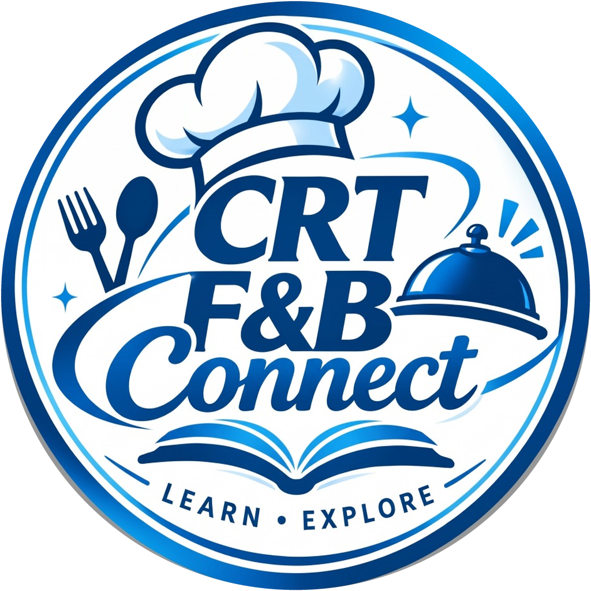
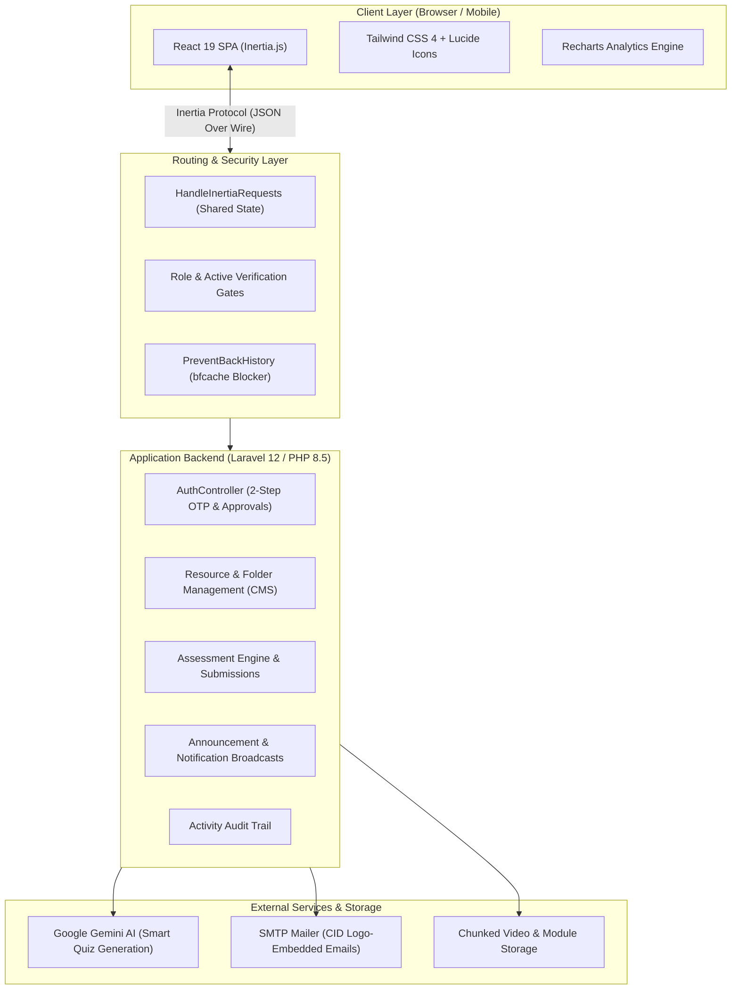
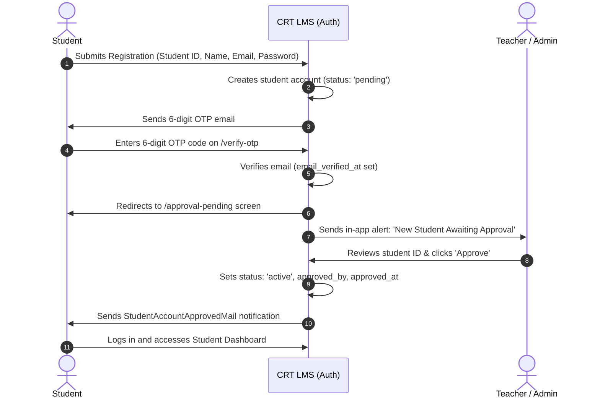
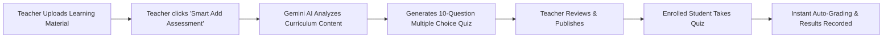
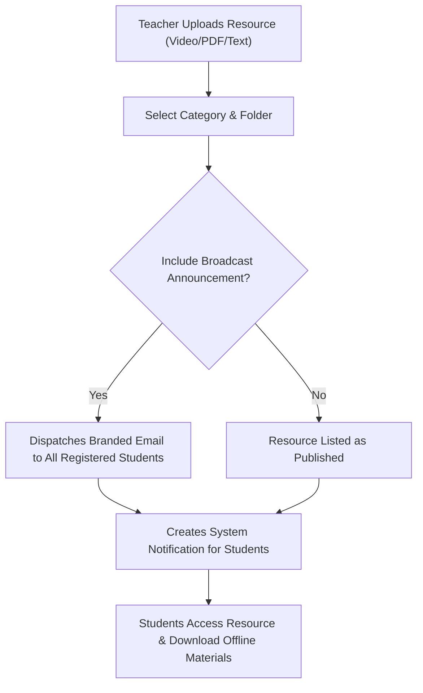

# CRT F&B Connect — Digital Learning Management System

<p align="center">
  
</p>

<p align="center">
  <strong>College of Research &amp; Technology (CRT)</strong><br>
  <em>Department of Food &amp; Beverage Services Management</em><br>
  <strong>Bachelor of Technical-Vocational Teacher Education (BTVTEd)</strong>
</p>

<p align="center">
  
  
  
  
  
  
</p>

---

## 📌 Institutional Vision & Mission

### Vision
> *"To be a premier, accessible, and innovative digital learning platform that empowers Bachelor of Technical-Vocational Teacher Education (BTVTEd) students with industry-standard competencies, bridging theoretical knowledge and practical excellence in Food and Beverage Services."*

### Mission
> *"To provide a comprehensive, multimedia-enhanced digital handbook system that delivers organized learning materials, clear video demonstrations, step-by-step procedures, and interactive activities, ensuring flexible, self-paced, and engaging skill development for future technical-vocational educators."*

---

## 🏛️ System Architecture

CRT F&amp;B Connect uses a modern **Single-Page Application (SPA)** architecture powered by **Inertia.js**, seamlessly coupling a high-performance **Laravel 12** backend with a dynamic **React 19** frontend without the latency or complexity of detached REST client state management.



### Key Architectural Highlights
1. **Inertia.js Monolith-SPA**: Eliminates traditional client-side API boilerplate while preserving responsive, zero-page-reload client navigation.
2. **State & Flash Management**: Centralized flash banners (`success`, `error`, `info`) and real-time auth contexts shared through `HandleInertiaRequests`.
3. **Zero-Stale Cache Policy**: `PreventBackHistory` middleware injects HTTP cache-invalidation headers (`no-cache, no-store, must-revalidate`), preventing browser back-forward cache (bfcache) from exposing sensitive student sessions upon navigation.
4. **Session Persistence Rule**: `redirectUsersTo` ensures logged-in students and instructors navigating to landing or login routes are smoothly directed to their respective dashboards.

---

## 💻 Tech Stack

| Domain | Technology | Version | Purpose |
| :--- | :--- | :--- | :--- |
| **Backend Framework** | Laravel | `12.x` | Core application framework, MVC routing, and ORM |
| **Backend Runtime** | PHP | `8.5` | High-efficiency server-side scripting language |
| **Frontend Library** | React | `19.x` | Component-driven user interface architecture |
| **SPA Bridge** | Inertia.js React | `3.x` | Connects React frontend directly to Laravel controllers |
| **Styling & Design** | Tailwind CSS | `4.x` | Modern utility-first CSS design system |
| **Iconography** | Lucide React | `1.72.x` | Lightweight, consistent SVG interface icons |
| **Data Visualization** | Recharts | `3.10.x` | Assessment scores and student engagement charts |
| **Artificial Intelligence** | Google Gemini 2.5 Flash | API | Automated assessment and quiz generation from materials |
| **Build & Bundling** | Vite | `8.x` | Ultra-fast client-side asset compilation and HMR |
| **Quality & Styling** | Laravel Pint | `1.27.x` | Automated PHP CS fixer following framework standards |
| **Testing Suite** | PHPUnit | `12.5.x` | Comprehensive Feature & Unit regression testing |

---

## 🚀 Core Features & Modules

### 1. Two-Step Student Account Verification Gate
To eliminate dummy accounts and protect learning materials, student registration enforces a mandatory two-step gate:
- **Step 1 — Email OTP**: Upon registration on `/register`, a random 6-digit one-time PIN (valid for 10 minutes) is emailed with embedded CRT branding. The student inputs the code on `/verify-otp`. Rate limiting is strictly enforced on resends.
- **Step 2 — Instructor Approval**: Once email verification succeeds, the account remains in `pending` status. Access to classroom materials is blocked until a Food &amp; Beverage instructor reviews the applicant's student ID and clicks **Approve** in the faculty portal. An approval email is dispatched immediately.



---

### 2. Digital Resource Management (Handbook & CMS)
A structured curriculum repository tailored for Bachelor of Technical-Vocational Teacher Education:
- **Hierarchical Folders**: Multi-level directories (`ResourceFolder`) with breadcrumb navigation.
- **Multi-Format Learning Content**:
  - 🎥 **Video Lessons**: In-browser video player supporting local MP4/WebM uploads with chunked HTTP 206 streaming and embedded external demonstrations (YouTube, Vimeo).
  - 📄 **PDF Modules**: High-definition downloadable and streamable TESDA NC II modules, syllabi, and rubrics.
  - 📝 **Text Lessons & Procedures**: Formatted digital handbook procedures, recipes, and dining room service sequences.
  - 🖼️ **Illustrations & Diagrams**: High-resolution dining table covers, glassware layouts, cutlery settings, and napkin fold guides.
- **Mass Announcements**: Teachers can upload a resource and broadcast an announcement email directly to all enrolled students with a single click.

---

### 3. Smart AI Assessment Engine
Automates academic evaluation and skill testing:
- **AI-Powered Quiz Generation**: Integrates Google Gemini AI (`GeminiAssessmentService`) to analyze lesson descriptions, procedures, and uploaded content, generating a 10-question multiple-choice quiz complete with answer choices, correct keys, and pedagogical rationales.
- **Student Exam Interface**: Clean, accessible testing environment with progress tracking, randomized question sets, and instant auto-grading upon submission.
- **Teacher Analytics & Management**:
  - Detailed submission inspector displaying per-student answers, score distributions, and completion timestamps.
  - Publishing controls to activate or pause quiz availability.
  - Submission management with deletion and re-take capabilities.

---

### 4. Faculty & Student Administration
- **Student Directory**: Real-time searchable and filterable roster (Total, Active, Pending Approval, Inactive). Quick-action buttons for one-click approval, dummy rejection, or account status toggles.
- **CSV Roster Export**: One-click download of institutional student rosters formatted with UTF-8 BOM encoding for seamless Microsoft Excel compatibility.
- **Faculty & Staff Accounts**: Administrator portal allows adding teachers and faculty members, assigning administrative privileges, and managing faculty credentials.
- **Activity Audit Trail**: Continuous system activity logging (`ActivityLog`) tracking logins, registrations, resource additions, downloads, views, and assessment submissions.

---

## 🔄 Core Workflows

### Smart Assessment Generation Workflow


### Resource Publication & Broadcast Workflow


---

## 🔒 Security & Data Integrity

- **Two-Factor Access Control Gate**: Unverified emails and unapproved registrations cannot access protected learning routes (`EnsureUserRole` and `EnsureUserIsActive` middleware).
- **Session & Back-Button Protection**: Response headers disallow browser caching of authenticated views. Authenticated users attempting to view login routes are automatically routed back to their dashboard.
- **Password Security**: Passwords hashed using industry-standard Bcrypt with 12 rounds.
- **Rate Limiting**: Throttling applied to authentication attempts (5 attempts/min) and OTP resend requests (1 attempt/min).
- **Protection Against CSRF & Injection**: Inertia XHR requests are verified against Laravel CSRF tokens; database interactions leverage Eloquent parameterized queries to safeguard against SQL injection.
- **Audit Logging**: Sensitive actions (student account approvals, status deactivations, deletions, and CSV exports) are immutably logged with actor user IDs and timestamps.

---

## 🛠️ Project Structure

```
CRT_F&B_Connect/
├── app/
│   ├── Http/
│   │   ├── Controllers/
│   │   │   ├── Admin/           # Faculty & Admin controllers (Resources, Assessments, Students, Settings)
│   │   │   ├── Student/         # Student portal controllers (Dashboard, Resources, Assessments)
│   │   │   ├── AuthController.php # Two-step OTP verification & login handling
│   │   │   └── LandingController.php # Public landing page
│   │   └── Middleware/          # Role, Active, Inertia, and PreventBackHistory middleware
│   ├── Mail/                    # Mailable classes (OTP Verification, Approval, Broadcasts)
│   ├── Models/                  # Eloquent models (User, Resource, Assessment, Submission, etc.)
│   └── Services/                # Service classes (Gemini AI Quiz Generation)
├── database/
│   ├── factories/               # Model factories for testing
│   ├── migrations/              # Database schema migrations
│   └── seeders/                 # Database seeders
├── resources/
│   ├── js/
│   │   ├── Components/          # Reusable React components (Modals, Toast, Pagination, Logo)
│   │   ├── Layouts/             # AppLayout (Authenticated) & GuestLayout (Auth)
│   │   └── Pages/               # Inertia view pages (Admin, Student, Auth, Landing)
│   └── views/
│       ├── emails/              # HTML Blade email templates with CID logo integration
│       └── app.blade.php        # Root Inertia HTML template
├── routes/
│   ├── web.php                  # Web route definitions & role middleware groups
│   └── console.php              # Scheduled commands & artisan routines
└── tests/
    └── Feature/                 # PHPUnit integration and feature tests
```

---

## ⚙️ Local Development Setup

### Prerequisites
- **PHP**: `^8.3` or `^8.5` with `pdo`, `mbstring`, `fileinfo`, `openssl` extensions enabled
- **Composer**: `^2.x`
- **Node.js**: `^20.x` or `^22.x`
- **NPM**: `^10.x`

### Installation Steps

1. **Clone the repository**:
   ```bash
   git clone https://github.com/your-username/CRT_F-B_Connect.git
   cd CRT_F-B_Connect
   ```

2. **Install PHP dependencies**:
   ```bash
   composer install
   ```

3. **Install JavaScript dependencies**:
   ```bash
   npm install
   ```

4. **Configure Environment File**:
   Copy the example configuration:
   ```bash
   cp .env.example .env
   php artisan key:generate
   ```
   *Configure your email mailer (SMTP/Log) and Google Gemini API key (`GEMINI_API_KEY`) within `.env` as needed.*

5. **Run Database Migrations & Seeders**:
   ```bash
   php artisan migrate --seed
   ```

6. **Create Storage Symlink**:
   ```bash
   php artisan storage:link
   ```

7. **Start Development Server**:
   Run both backend and frontend development servers concurrently:
   ```bash
   composer run dev
   ```
   *(Or run `php artisan serve` and `npm run dev` in separate terminals).*

---

## 🧪 Testing & Code Standards

### Running Automated Tests
The project features a comprehensive test suite covering authentication, two-step OTP verification, approval gates, resource management, and assessment submissions:

```bash
php artisan test --compact
```

### Running Code Formatter
To maintain uniform code styling across all PHP files:

```bash
php vendor/bin/pint --format agent
```

### Building for Production
To compile and minify all React and Tailwind CSS assets:

```bash
npm run build
```

---

## 📄 License
This project is proprietary software developed for the **College of Research &amp; Technology (CRT)**, Department of Food and Beverage Services Management. All rights reserved.
